# EECS3311 Course Project: Stage 2 Implementation Report

CareerPilot, an AI job application assistant

Muhammad Abbas Kermali  
Fall 2026  
Repository: https://github.com/muhammad-kermali/EECS3311-CareerPilot

Demo videos: [Part 1 (F01 to F06)](https://youtu.be/Uz7fT3sWZ2U), [Part 2 (F07 to F12)](https://youtu.be/4y0vOQqgCr8) and [Part 3 (one task in the GUI, then the CLI)](https://youtu.be/Ty_fys1pfW8)

## 1. Project overview and implementation status

CareerPilot is a Java 17 desktop app that helps students prepare job applications. It has a Swing GUI and a command-line interface (CLI), and both of them call the same CareerAssistantFacade, which sends each request to the right service. Everything is saved locally as JSON files with IDs and revision numbers.

**AI.** The app talks to the AI through OpenAILLMAdapter, which works with any OpenAI-compatible API. I used Google's free gemini-3.1-flash-lite model. OpenAI's gpt-4.1-mini (my Stage 1 choice) also works by changing two settings. The AI reads resumes and job postings, compares them, writes documents and interview questions, gives feedback, and runs the agent. Normal Java code handles checking, saving, dates and export.

**Agent.** In F11, CareerAgent decides for itself which of six tools to use (get_profile, get_job, analyze_fit, inspect_documents, draft_application, validate_plan). It checks its own plan before answering and asks a question if info is missing. It stops after 8 tool calls or 180 seconds, and it can't save anything. I save the plan myself.

**Keeping the AI honest.** Every claim the AI makes about me has to point to a real fact in my profile, like experience:E1:bullet:0 with a quote. EvidenceValidator checks that the fact exists, that the quote matches, and that the AI didn't add new numbers. Resume changes without real evidence can't be saved, and job requirements have to quote the posting exactly.

**Status.** All 12 features from Stage 1 work in both the GUI and the CLI, and I tested all of them with the real model. Testing with the real model found six bugs that the fake test model didn't, and they're all fixed (section 6). For Stage 3, I added a standalone CLI that runs a task from a file or standard input (section 2.2). There are 66 automated tests and they all pass.

**Limitations.**

- Only text PDF, TXT and MD resumes work (no scanned PDFs or Word files).
- Tailoring rewrites lines in the resume but doesn't reorder sections.
- The checks catch made-up facts, wrong quotes and new numbers, but they can't prove a reworded sentence means exactly the same thing, so I still review every draft.
- One profile per workspace.
- The free Gemini tier has rate limits and can be slow. Failed calls are retried, but sometimes you have to try again a minute later.
- A small free model sometimes doesn't follow the format exactly. The code catches this, asks once for a fix, and drops anything that's still wrong.

## 2. Feature to implementation mapping

Every feature enters through CareerGUI.submit() or CareerCLI.submit(), then CareerAssistantFacade.execute(), which dispatches on Operation and returns a FeatureResult. Paths below are under src/main/java/careerpilot/.

| ID | Feature | Stage 1 | Status | Main classes / files | Key methods | Patterns | Video |
|---|---|---|---|---|---|---|---|
| F01 | Import resume and extract profile | F01 | Implemented (modified, see 2.1) | service/ProfileService, parsing/ResumeImporter, PdfResumeImporter, TxtResumeImporter, PdfTextParser, PlainTextParser, ai/StructuredOutput | importResume(), importText(), createParser(), extractText(), confirmImport() | Facade, Factory Method, Adapter, Decorator | [Part 1, F01 segment](https://youtu.be/Uz7fT3sWZ2U) |
| F02 | Review and correct profile | F02 | Implemented | service/ProfileService, domain/CandidateProfile, storage/JsonWorkspaceRepository, ui/gui/ProfilePanel | getProfile(), updateProfile(), validate(), save() | Facade | [Part 1, F02 segment](https://youtu.be/Uz7fT3sWZ2U) |
| F03 | Import and analyze a job | F03 | Implemented | service/JobService, domain/JobPosting, Requirement, JobPreview | analyzeJob(), detectDeadline(), saveJob() | Facade, Adapter, Decorator | [Part 1, F03 segment](https://youtu.be/Uz7fT3sWZ2U) |
| F04 | Fit analysis with evidence | F04 | Implemented | service/AnalysisService, EvidenceValidator, domain/FitReport | analyzeFit(), readEvidence(), isStaleFor() | Facade, Adapter, Decorator | [Part 1, F04 segment](https://youtu.be/Uz7fT3sWZ2U) |
| F05 | Gaps and next steps | F05 | Implemented | service/AnalysisService, domain/GapReport, GapAction | identifyGaps(), currentFit() | Facade, Adapter, Decorator | [Part 1, F05 segment](https://youtu.be/Uz7fT3sWZ2U) |
| F06 | Tailored resume version | F06 | Implemented | service/DocumentService, domain/Resume, ResumePrototype, ResumeChange | tailorResume(), deepCopy(), saveDraft() | Facade, Prototype, Adapter, Decorator | [Part 1, F06 segment](https://youtu.be/Uz7fT3sWZ2U) |
| F07 | Cover letter draft | F07 | Implemented | service/DocumentService, domain/CoverLetter, LetterParagraph | draftLetter(), saveDraft() | Facade, Adapter, Decorator | [Part 2, F07 segment](https://youtu.be/4y0vOQqgCr8) |
| F08 | Interview questions | F08 | Implemented | service/InterviewService, domain/QuestionSet, InterviewQuestion | generateQuestions() | Facade, Adapter, Decorator | [Part 2, F08 segment](https://youtu.be/4y0vOQqgCr8) |
| F09 | Mock interview with feedback | F09 | Implemented (modified, see 2.1) | service/InterviewService, AnswerOutcome, domain/InterviewSession, AnswerRecord, Feedback | startInterview(), submitAnswer(), retryFeedback(), pauseInterview() | Facade, Adapter, Decorator | [Part 2, F09 segment](https://youtu.be/4y0vOQqgCr8) |
| F10 | Application tracking | F10 | Implemented | service/ApplicationService, ApplicationView, domain/ApplicationRecord, ApplicationStatus | updateApplication(), listApplications(), isOverdue() | Facade | [Part 2, F10 segment](https://youtu.be/4y0vOQqgCr8) |
| F11 | Application preparation agent | F11 | Implemented (modified, see 2.1) | service/PlanService, agent/CareerAgent, ToolRegistry, ToolCommand, InvokeToolCommand, AgentTool, agent/tools/*, service/PlanValidator | prepareApplication(), run(), executeTool(), execute(), validate(), savePlan() | Facade, Command, Adapter, Decorator | [Part 2, F11 segment](https://youtu.be/4y0vOQqgCr8), [Part 3](https://youtu.be/Ty_fys1pfW8) |
| F12 | Export application package | F12 | Implemented | service/ExportService, export/ApplicationPackageDirector, ApplicationPackageBuilder, MarkdownPackageBuilder, TextPackageBuilder, FileExporter | exportPackage(), construct(), reset(), addResume(), build(), write() | Facade, Builder | [Part 2, F12 segment](https://youtu.be/4y0vOQqgCr8) |

## 2.1 Each feature: requirement, screenshot, implementation and changes

For each feature: what I planned in Stage 1 (shortened), a screenshot, how I built it, and what changed. The screenshots are from my demo videos.

### F01 Import resume and extract profile (hybrid)

**Stage 1 plan.** Import a PDF or TXT resume (max 5 MB). The AI pulls out the profile info, I check a preview, and then the profile and resume get saved. Bad files (wrong type, encrypted, scanned or empty) are rejected and nothing is saved.

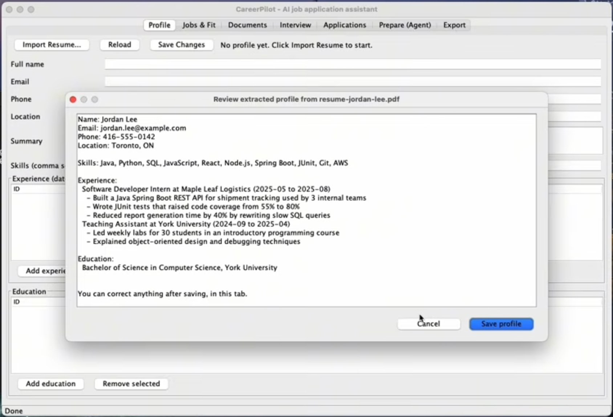{width=5.6in}

**How I built it.** ProfileService.importResume() picks an importer based on the file type (Factory Method) and reads the text with PDFBox. The text goes to the AI, which sends back the profile as JSON. The code checks that JSON, finds the email and phone itself, and warns about any skill that isn't really in the resume. Saving happens in confirmImport().

**What changed.** Saving happens in confirmImport() instead of updateProfile(), since an import saves two new records at once. I also allowed .md files. After testing with Gemini, I added a check for missing resume sections, because one time the AI only gave back a Projects section.

**Video:** [Part 1](https://youtu.be/Uz7fT3sWZ2U)

### F02 Review and correct profile (no AI)

**Stage 1 plan.** Edit the profile (skills, experience, education) and save it. Bad dates or empty required fields are rejected. If the profile changed somewhere else in the meantime, the save is blocked.

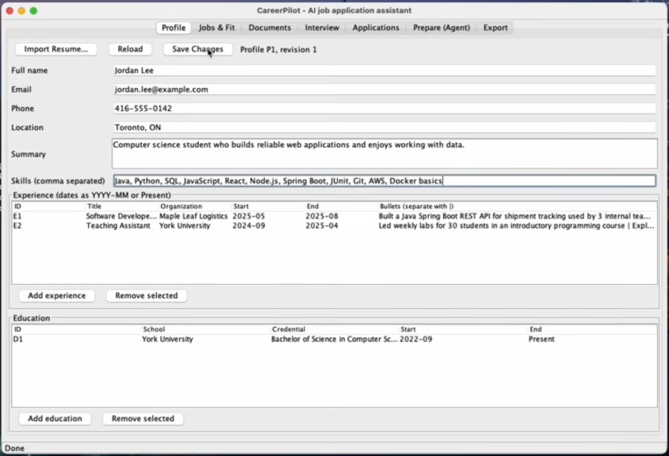{width=5.6in}

**How I built it.** updateProfile() checks the fields and the dates, then saves. Every save bumps a revision number, which is how the app knows older fit reports are out of date and stops two edits from overwriting each other.

**What changed.** No change. In the CLI, `career profile edit` uses flags like `--add-skill` instead of opening an editor.

**Video:** [Part 1](https://youtu.be/Uz7fT3sWZ2U)

### F03 Import and analyze a job (hybrid)

**Stage 1 plan.** Paste or load a job posting. The AI lists the requirements, each with a quote from the posting. I review them and save. Empty input is rejected and an unknown deadline stays blank.

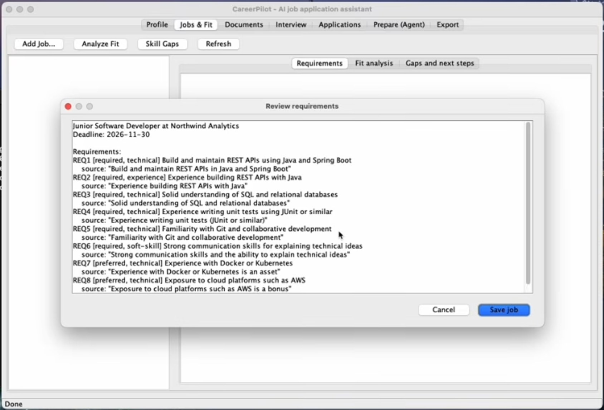{width=5.6in}

**How I built it.** JobService.analyzeJob() finds the deadline with regular code and asks the AI for the requirements. The code checks that every quote really appears in the posting, so the AI can't make up requirements. Bad quotes get one retry and are then dropped with a warning.

**What changed.** analyzeJob() returns a preview with warnings instead of just the job, so I can see if anything was dropped before saving.

**Video:** [Part 1](https://youtu.be/Uz7fT3sWZ2U)

### F04 Fit analysis with evidence (hybrid)

**Stage 1 plan.** Compare the profile with each job requirement and mark it Supported, Partial or Not Evidenced, with the profile fact it's based on. It should not predict whether I'll get hired.

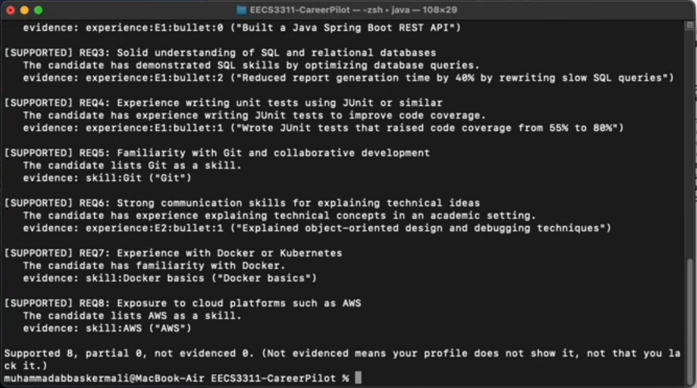{width=5.6in}

**How I built it.** AnalysisService.analyzeFit() sends the profile facts and the requirements to the AI. EvidenceValidator checks that every piece of evidence really exists in the profile. The report remembers which profile and job versions it used.

**What changed.** In Stage 1, bad evidence after one retry was an error. Now only the bad evidence is removed and that requirement becomes Not Evidenced, so one mistake doesn't throw away the whole report. I also made the evidence check accept small format differences, because Gemini wrote the paths its own way.

**Video:** [Part 1](https://youtu.be/Uz7fT3sWZ2U)

### F05 Gaps and next steps (hybrid)

**Stage 1 plan.** For requirements that aren't fully supported, suggest a next step, split into "missing evidence" and "things to learn". If the fit report is old, make a new one first. No gaps gives an empty report.

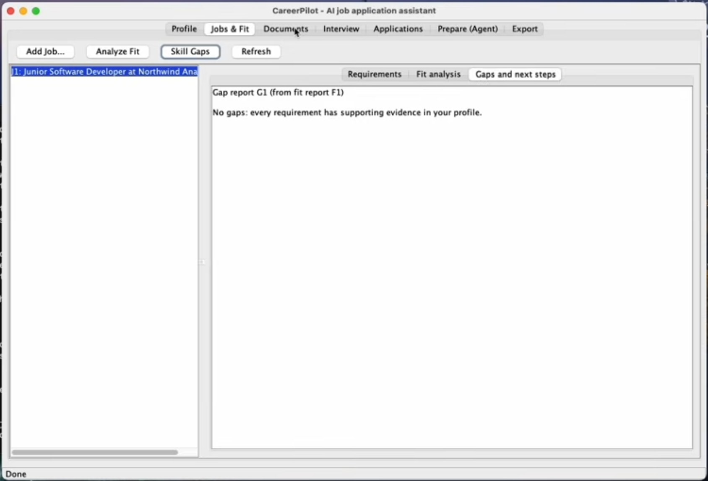{width=5.6in}

**How I built it.** identifyGaps() reuses the latest fit report or makes a new one if it's out of date. The AI suggests one action per gap, and the code checks that every gap got exactly one.

**What changed.** No change.

**Video:** [Part 1](https://youtu.be/Uz7fT3sWZ2U)

### F06 Tailored resume version (hybrid)

**Stage 1 plan.** Make a copy of the resume tailored to the job. The AI suggests changes backed by evidence, I pick which ones to keep, and the original resume never changes.

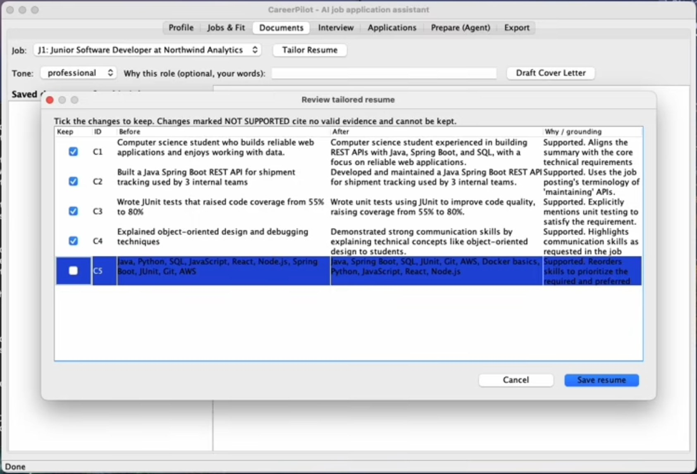{width=5.6in}

**How I built it.** DocumentService.tailorResume() makes a deep copy of the resume (Prototype), so the original is safe. A change only counts as supported if its evidence is real and it doesn't add new numbers. Only the ticked changes get saved.

**What changed.** Stage 1 said unsupported changes get flagged. Now they can't be kept at all, which is stricter but keeps made-up claims out of the resume.

**Video:** [Part 1](https://youtu.be/Uz7fT3sWZ2U)

### F07 Cover letter draft (hybrid)

**Stage 1 plan.** Write a cover letter for a job with a chosen tone. Every claim about me has to come from my profile, and I review it before saving.

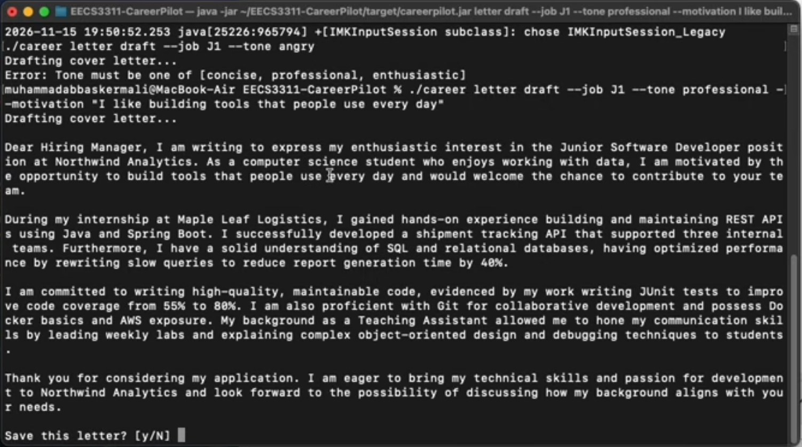{width=5.6in}

**How I built it.** draftLetter() checks the tone and sends my profile facts, the requirements and my own motivation to the AI. The code checks each paragraph's evidence and numbers. A letter with unsupported paragraphs can't be saved until it's fixed.

**What changed.** When I tested with Gemini, the warnings weren't being shown and a true letter got blocked. Now the warnings show up, numbers can come from anywhere in my profile, and bad evidence gets one retry.

**Video:** [Part 2](https://youtu.be/4y0vOQqgCr8)

### F08 Interview questions (hybrid)

**Stage 1 plan.** Make 1 to 20 practice questions for the job, technical or behavioural, each linked to real requirements.

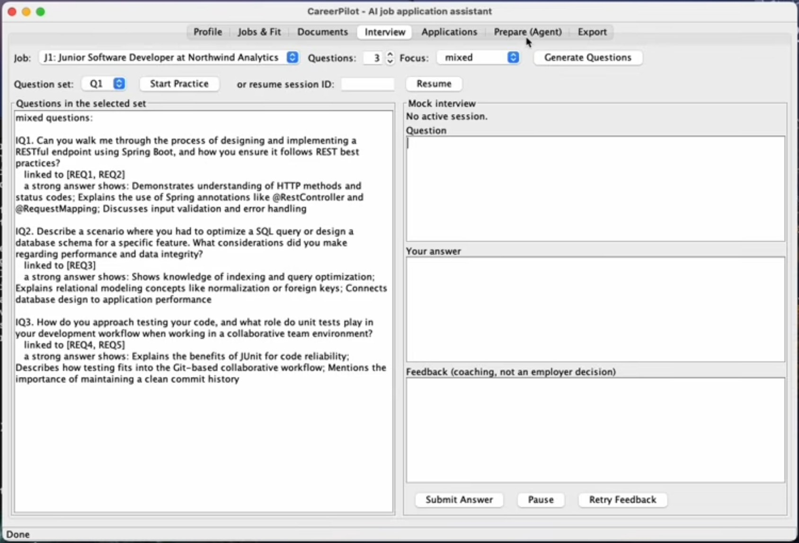{width=5.6in}

**How I built it.** InterviewService.generateQuestions() checks the count, asks the AI, and makes sure it got exactly that many questions, all linked to real requirement IDs.

**What changed.** Added a "mixed" focus that combines both kinds of questions.

**Video:** [Part 2](https://youtu.be/4y0vOQqgCr8)

### F09 Mock interview with feedback (hybrid)

**Stage 1 plan.** Answer the questions one by one and get feedback. Blank answers are rejected. If the feedback fails, the answer is still saved. I can pause and come back later.

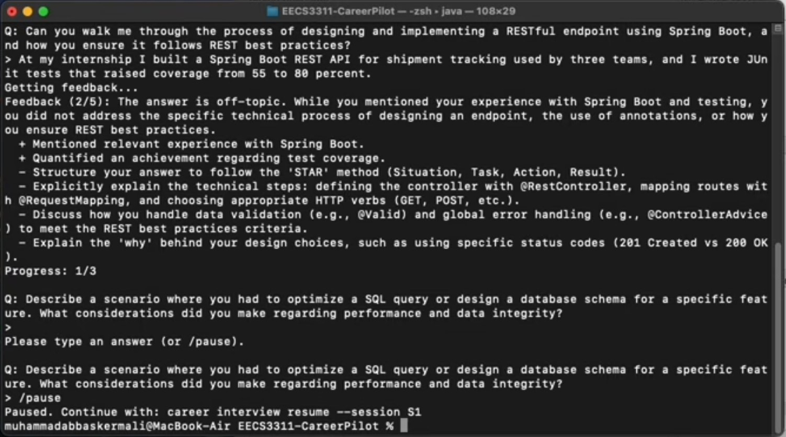{width=5.6in}

**How I built it.** submitAnswer() saves the answer first and then asks the AI for feedback. If the AI fails, the answer is marked as pending and retryFeedback() can fill it in later.

**What changed.** Each answer is now stored with its own feedback and pending flag, which was needed for retries. It works the same way as planned.

**Video:** [Part 2](https://youtu.be/4y0vOQqgCr8)

### F10 Application tracking (no AI)

**Stage 1 plan.** Keep track of each application's status, notes and deadline, and show which ones are overdue. Bad dates or statuses are rejected. I always set the status myself.

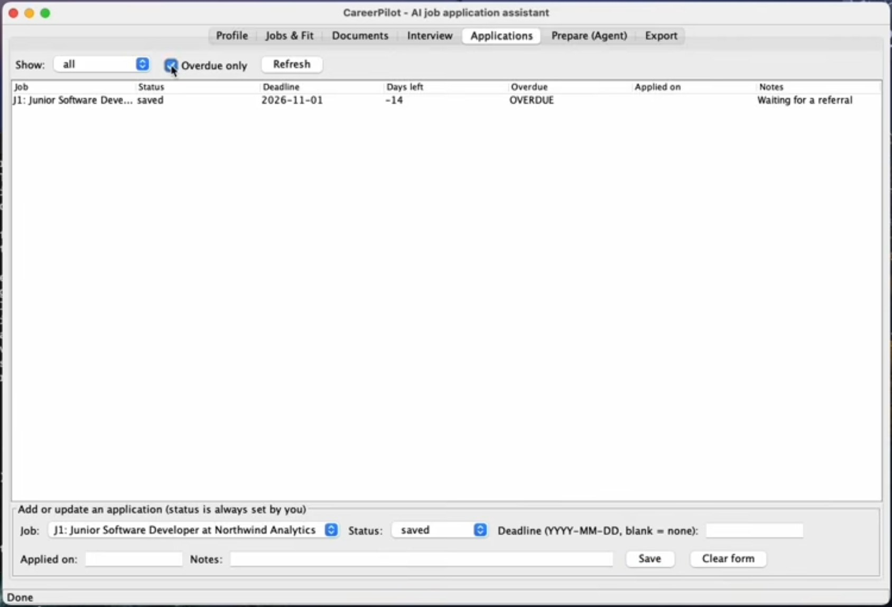{width=5.6in}

**How I built it.** ApplicationService.updateApplication() checks the dates and status and saves the record. listApplications() filters the list and works out overdue and days left from today's date.

**What changed.** No change.

**Video:** [Part 2](https://youtu.be/4y0vOQqgCr8)

### F11 Application preparation agent (agent)

**Stage 1 plan.** The agent decides by itself which tools to use to make a plan that fits my time. It stops at 8 tool calls or 60 seconds, asks me if it's missing info, and can't save anything. I save the plan myself.

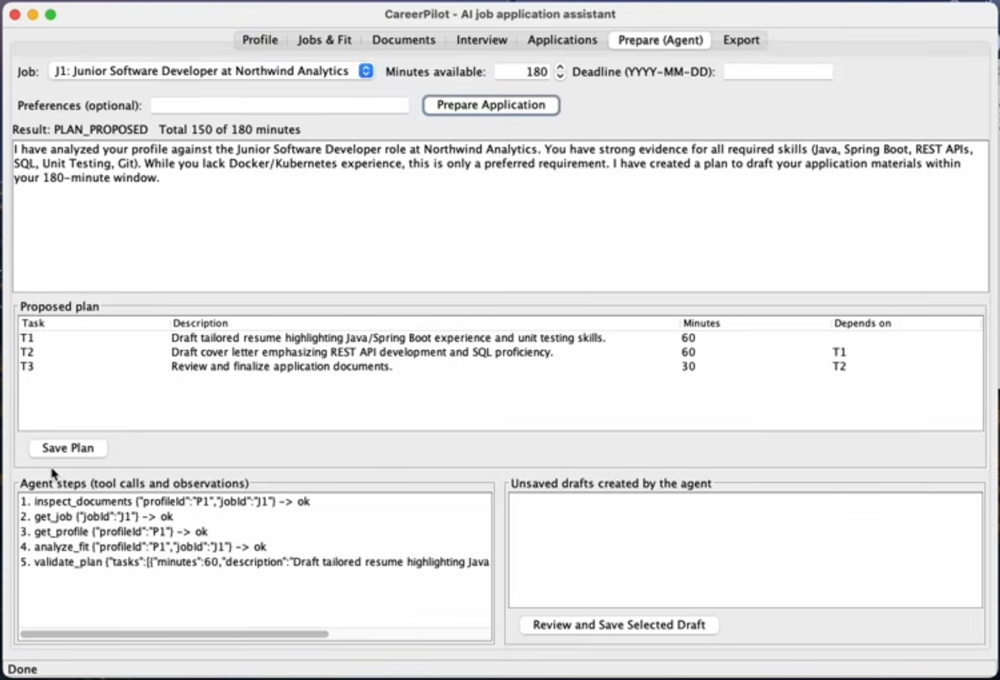{width=5.6in}

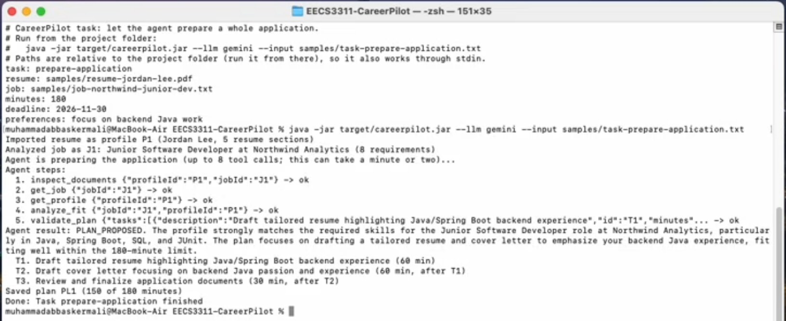{width=5.6in}

**How I built it.** CareerAgent.run() loops: each turn the AI either asks for a tool or gives its final answer. ToolRegistry checks each tool request and runs it as a command object (Command pattern). PlanValidator checks the final plan's time and order.

**What changed.** Tool names use snake_case, which is normal for AI tools. I also had to send back a "thought signature" Gemini adds to tool calls, or the agent failed. The time limit is now 180 seconds instead of 60. With the free Gemini tier the agent kept timing out, and one call hung for 156 seconds, so I also added a hard limit to each AI call. The 8 tool call limit is the same. The agent can now also be run from the standalone CLI (section 2.2).

**Video:** [Part 2](https://youtu.be/4y0vOQqgCr8), [Part 3](https://youtu.be/Ty_fys1pfW8)

### F12 Export application package (no AI)

**Stage 1 plan.** Export the reviewed resume, cover letter and plan for a job into one folder in Markdown or text. Unreviewed documents and existing folders are refused. Nothing is sent to anyone.

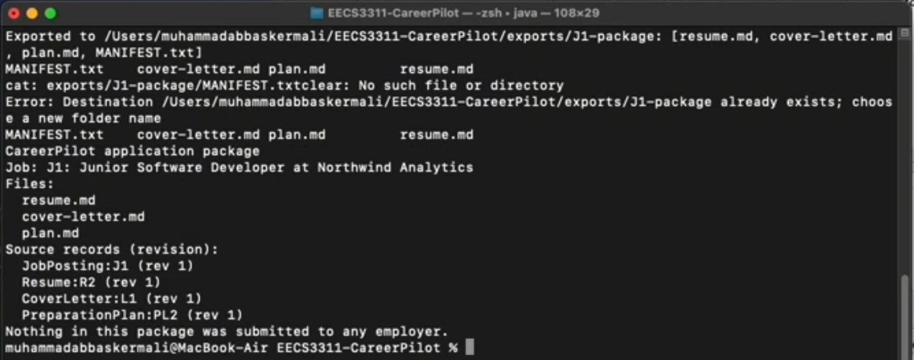{width=5.6in}

**How I built it.** ExportService.exportPackage() gets the reviewed documents. A director and a builder (Builder pattern) put the package together, and FileExporter writes it to a temp folder first and then renames it, so you never get half a package.

**What changed.** reset() now gets the job, because the header needs it. Export also warns if a document was made from an older profile.

**Video:** [Part 2](https://youtu.be/4y0vOQqgCr8)

## 2.2 Standalone CLI (added for Stage 3)

The CLI can now run a whole task from a file or from standard input without asking any questions. It uses the same facade as the GUI, so it does the exact same checks. The README has the full instructions and an example.

```
java -jar target/careerpilot.jar --llm gemini --input samples/task-prepare-application.txt
cat samples/task-fit.txt | java -jar target/careerpilot.jar --llm gemini --json --input -
```

| Option | What it does |
|---|---|
| `--input FILE` (or `-` for stdin) | The task to run |
| `--llm gemini/openai/ollama` (or `-LLMAPI`) | Which AI provider to use |
| `--llm-model`, `--llm-base-url` | Change the model or the endpoint |
| `--json` | Print the result as JSON, for scripts and testing |
| `--help` | Show all options |

A task file is just `key: value` lines (task, resume, job, minutes, and so on). Exit code 0 means it worked, 1 means a step failed, and 2 means the task file was wrong. The F11 CLI screenshot shows it running, and [Part 3](https://youtu.be/Ty_fys1pfW8) shows the same task in the GUI and then in the CLI.

## 3. Implemented design patterns

All seven Stage 1 patterns are implemented as designed. Updated class diagrams: docs/uml/A-application.png, B-ai-agent.png, C-domain-export-parsing.png (Mermaid sources beside them). The Stage 1 use-case and sequence diagrams still describe the implemented flows; small differences are listed in section 4.

| Pattern | Problem | Participants (role) | Files and methods | Matches Stage 1? |
|---|---|---|---|---|
| Facade | GUI and CLI need the same operations without duplicating coordination and error handling | CareerAssistantFacade (facade); services (subsystem); CareerGUI, CareerCLI (clients) | app/CareerAssistantFacade.execute(), dispatch() | Yes |
| Adapter | The provider's request/response format must not spread through the services | LLMClient (target), OpenAILLMAdapter (adapter), ProviderClient (adaptee) | ai/OpenAILLMAdapter.generate(), toProviderJson(), fromProviderJson() | Yes |
| Decorator | Model calls need logging and automatic retry of temporary errors without changing provider code | LLMClient (component), OpenAILLMAdapter (concrete component), LoggingLLMClient, RetryingLLMClient (decorators, stacked in AppFactory) | ai/LoggingLLMClient.generate() logs timing and tokens but never text; ai/RetryingLLMClient.generate() retries 429/5xx/timeouts with 2, 4, 8 second waits | Extended: second decorator added |
| Prototype | Tailoring must not change the base resume through shared lists | ResumePrototype (prototype interface), Resume (concrete prototype), DocumentService (client) | domain/Resume.deepCopy(), ResumeSection.copy() | Yes |
| Builder | The same selected documents must be assembled into Markdown or text without format conditions in the service | ApplicationPackageDirector (director), ApplicationPackageBuilder (builder), MarkdownPackageBuilder, TextPackageBuilder (concrete builders), ApplicationPackage (product) | export/ApplicationPackageDirector.construct() | Yes; reset() now receives the job (see 4) |
| Command | Each validated tool request should be a self-contained object, separate from the agent loop | ToolRegistry (invoker), ToolCommand (command), InvokeToolCommand (concrete command), AgentTool implementations (receivers), CareerAgent (client) | agent/ToolRegistry.executeTool(), InvokeToolCommand.execute() | Yes |
| Factory Method | The import workflow should not change when a file format is added | ResumeImporter (creator), PdfResumeImporter, TxtResumeImporter (concrete creators), DocumentParser (product), PdfTextParser, PlainTextParser (concrete products) | parsing/ResumeImporter.importText() calls createParser() | Yes |


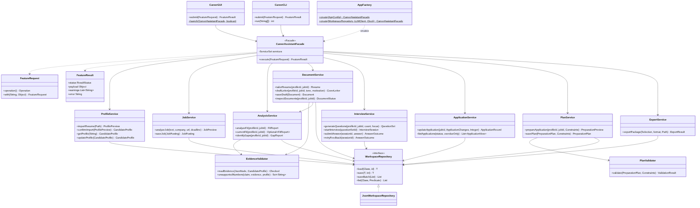{width=6.3in}


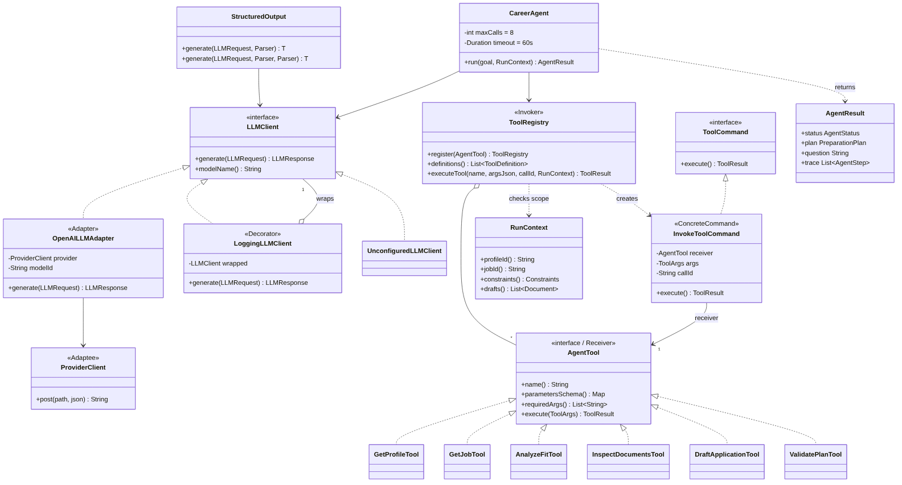{width=6.3in}


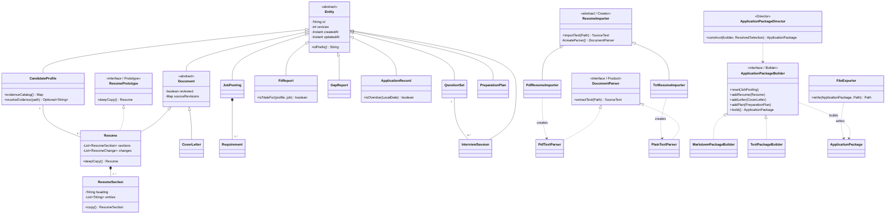{width=6.3in}

## 4. Changes and rationale

| Original design | Implemented change | Reason | Impact |
|---|---|---|---|
| updateProfile() saved both imports and edits | Imports are saved by ProfileService.confirmImport(); edits by updateProfile() | Import needs saveBatch() of two new records; edits need a revision check on one existing record | F01/F02, SD01; facade operations CONFIRM_PROFILE and UPDATE_PROFILE |
| JobService.analyzeJob() returned JobPosting | Returns JobPreview (job plus warnings) | Dropped requirements and missing deadlines must be shown to the user | F03, SD02 |
| Invalid fit evidence: one repair, then error | One repair, then invalid evidence is removed and the match is downgraded to NOT_EVIDENCED with a warning | A single bad citation should not discard a whole useful report; the downgrade keeps it honest | F04 |
| InterviewSession.answers: List<String> | List<AnswerRecord> (answer, feedback, pending flag, time) | Pending feedback and retries need per-answer state | F09, class diagram E |
| ApplicationPackageBuilder.reset() | reset(JobPosting job) and a shared AbstractPackageBuilder | Headers and the manifest need the job; the abstract class removes duplicated state | F12, Builder participants unchanged |
| Agent tool names getProfile, getJob, ... | get_profile, get_job, ... | Snake case is the common convention for model function names | F11 |
| Not in Stage 1 | StructuredOutput helper | One place implements the "at most one repair" rule from SD08 for every service | All hybrid features |
| Not in Stage 1 | EvidenceValidator | Shared grounding checks for F04, F06, F07 | F04, F06, F07 |
| Not in Stage 1 | AppFactory (composition root), AppConfig (.env loading), UnconfiguredLLMClient | Wire concrete classes in one place; keep keys out of code; give a clear message when no key is set | Startup only |
| Not in Stage 1 | Export warns when a document was made from an older profile or job | Stale documents should not be exported silently | F12 |
| PDF/TXT resumes | PDF/TXT/MD resumes | Markdown is plain text and needs no new parser class | F01 |
| GPT-4.1 mini via OpenAI | Gemini gemini-3.1-flash-lite (free tier) through Gemini's OpenAI-compatible endpoint; any OpenAI-compatible provider via LLM_BASE_URL and LLM_MODEL | Avoids API cost; the assignment allows free models; no code depended on the provider thanks to the Adapter | Configuration, README, .env.example |
| Tool calls carried only ID, name and arguments | ToolCall also carries opaque provider data, which the adapter sends back unchanged | Gemini returns a thought_signature with tool calls and expects it back when the conversation continues; dropping it would break the agent | F11, ai/ToolCall, OpenAILLMAdapter |
| Only LoggingLLMClient decorated the model client | Added RetryingLLMClient, stacked around the logging decorator | The free tier can answer with temporary 429/503 errors; retrying with growing waits makes features more reliable | All AI features |
| Resume sections came only from the model | ProfileService checks that every experience bullet appears in the returned sections; if not, it asks for one repair, then rebuilds Summary, Education, Experience and Skills from the extracted profile | The real model once returned only a Projects section, which left tailoring almost nothing to work with | F01, F06 |
| Evidence paths had to match exactly | EvidenceValidator.canonicalPath() maps common variations (for example profile/experience/E1/bullet/0) to the catalog form; prompts show paths as [path] text; bad letter evidence gets one repair before anything is flagged | The real model wrote paths in its own format, which blocked a truthful cover letter; invented paths are still rejected | F04, F06, F07 |
| Letter numbers had to appear in the cited items | A number in a letter paragraph is supported if it appears anywhere in the confirmed profile, the posting, or the applicant's own motivation | A paragraph can combine several facts; requiring the exact cited item rejected true statements | F07 |
| Agent tab controls on one row | Controls split into two rows | The Prepare Application button was cut off at normal window sizes (found while recording) | F11 GUI |
| Agent stops at 8 calls / 60 seconds | 8 calls / 180 seconds (can be changed in .env), plus a hard time limit on each AI call | With free Gemini the agent kept timing out, and one call hung for 156 seconds | F11 |
| Interview focus technical or behavioural | Also mixed | Real interviews have both kinds of questions | F08 |
| Not in Stage 1 | Standalone CLI that runs a task from a file or stdin | Needed for Stage 3 testing | Main, ui/cli/LaunchOptions, TaskFile, TaskRunner |

## 5. AI tools and collaboration log

| Tool / platform | Model | Used for | Tokens and cost |
|---|---|---|---|
| Claude (claude.ai app, agentic coding session) | Configured as claude-opus-5-5 (the app notes the model serving a turn can differ) | Generated the initial implementation of all packages, the tests, sample data, README and report drafts; diagnosed and fixed the defects I found when testing with the real model; wrote the demo video script; built the standalone CLI and fixed the agent timeout | Tokens: not shown per conversation on the Claude Pro plan. Cost: Claude Pro subscription, $35/month as charged, no per-use charge |
| Application runtime model | gemini-3.1-flash-lite via Gemini API free tier | Used by CareerPilot itself, not a development tool | Free tier ($0); per-call token counts are logged in workspace/logs/llm-calls.log |

I did not record using any other AI development tool for Stage 2.

Representative interactions (keep the log in docs/ai-collaboration-log.md up to date and summarize it here):

| Date | Task | Input / Instruction | AI Contribution | Human Contribution | Outcome |
|---|---|---|---|---|---|
| 2026-11-01 | Implement the Stage 1 design | "Implement the Stage 1 design" with the exact Stage 1 names | Full first implementation (132 classes), 43 tests, GUI, CLI, sample data, docs | Built it locally, set up the git-ignored .env | Committed in 13 commits by area |
| 2026-11-02 | Avoid API cost | Asked for a free way to run the LLM | Gemini free tier or local Ollama | Chose the Gemini free tier and configured it | Runs on gemini-3.1-flash-lite with no code change (Adapter) |
| 2026-11-14 | First real-model test | Pasted the output of the sample flow | Fixes for the agent's HTTP 400 (thought signatures, null content, error details, retries) and missing resume sections (check, repair, rebuild) | Found both bugs by running the app with Gemini; applied and retested | 51 tests; 5 resume sections; agent PLAN_PROPOSED after 5 tool calls |
| 2026-11-14 | Fix the blocked cover letter | Reported a truthful letter blocked with no reason, then pasted the warnings | Visible warnings, evidence-path normalization, one repair attempt | Noticed the problem, reported it, retested until the letter saved | 54 tests; all 12 features work with the real model |
| 2026-11-15 | Record the demo videos | Asked for a video script, then reported the cut-off agent button | Two-part script; layout fix for the agent tab | Recorded both videos, noticed the hidden button, applied the fix and re-recorded part 2 | Two demo videos; fix committed |
| 2026-11-23 | Standalone CLI for Stage 3 | Shared the instructor's announcement and asked whether everything was covered | Wrote the standalone CLI, sample task files, README section and tests | Ran it with Gemini, found the agent timed out and the stdin example failed, and sent the log showing a call stuck for 156 seconds | Timeout fixed, 66 tests, pushed |
| 2026-11-24 | Part 3 video and report screenshots | Asked how to take a screenshot of each feature | Screenshot list; drafted section 2.1 from my Stage 1 report and the code | Recorded Part 3, took the screenshots, and asked for simpler wording | This report |

Full log: docs/ai-collaboration-log.md.

## 6. Development and verification summary

Weekly commit summary

| Period | Dates | Commits (links) |
|---|---|---|
| 1 | Oct 27-Nov 2 | 7 code commits: [e752680](https://github.com/muhammad-kermali/EECS3311-CareerPilot/commit/e752680), [cb9a018](https://github.com/muhammad-kermali/EECS3311-CareerPilot/commit/cb9a018), [f948515](https://github.com/muhammad-kermali/EECS3311-CareerPilot/commit/f948515), [9a167ce](https://github.com/muhammad-kermali/EECS3311-CareerPilot/commit/9a167ce), [ccf487a](https://github.com/muhammad-kermali/EECS3311-CareerPilot/commit/ccf487a), [f0b42c6](https://github.com/muhammad-kermali/EECS3311-CareerPilot/commit/f0b42c6), [41c0c30](https://github.com/muhammad-kermali/EECS3311-CareerPilot/commit/41c0c30) |
| 2 | Nov 3-9 | 5 code commits: [de92520](https://github.com/muhammad-kermali/EECS3311-CareerPilot/commit/de92520), [dd767b5](https://github.com/muhammad-kermali/EECS3311-CareerPilot/commit/dd767b5), [894a9ed](https://github.com/muhammad-kermali/EECS3311-CareerPilot/commit/894a9ed), [5af2304](https://github.com/muhammad-kermali/EECS3311-CareerPilot/commit/5af2304), [0a706d0](https://github.com/muhammad-kermali/EECS3311-CareerPilot/commit/0a706d0) |
| 3 | Nov 14-15 | 7 code commits fixing defects found with the real model: [0912874](https://github.com/muhammad-kermali/EECS3311-CareerPilot/commit/0912874), [7308be7](https://github.com/muhammad-kermali/EECS3311-CareerPilot/commit/7308be7), [1613327](https://github.com/muhammad-kermali/EECS3311-CareerPilot/commit/1613327), [a366268](https://github.com/muhammad-kermali/EECS3311-CareerPilot/commit/a366268), [46f1178](https://github.com/muhammad-kermali/EECS3311-CareerPilot/commit/46f1178), [e418dad](https://github.com/muhammad-kermali/EECS3311-CareerPilot/commit/e418dad), [c5f5eed](https://github.com/muhammad-kermali/EECS3311-CareerPilot/commit/c5f5eed) (plus docs commit [02056b8](https://github.com/muhammad-kermali/EECS3311-CareerPilot/commit/02056b8)) |
| After submission | Nov 23-24 | Standalone CLI and agent timeout fix: [848b4db](https://github.com/muhammad-kermali/EECS3311-CareerPilot/commit/848b4db); this report update |

Checks performed

- 66 automated tests (mvn test, all passing), including tests for the standalone CLI and the timeout fix: repository revision conflicts, Prototype independence, plan validation (cycles, unknown dependencies, time, deadline), evidence grounding, tool registry rejections, agent loop (tool feedback, 8-call limit, single repair, NEEDS_INPUT, provider failure), adapter request/response translation against a local HTTP server (including Gemini thought signatures and Gemini error lists), logging and retrying decorators, export builders and atomic writing, and end-to-end flows through the facade with a scripted model.
- Every CLI command was run end to end against a local OpenAI-compatible test server, including error paths: invalid dates, unsupported file types, AI service down, invalid quotes, invalid evidence, missing API key, stale revisions, existing export folders and the agent's scope, limit and infeasible cases.
- The GUI was launched and every tab was exercised, including fit analysis and the agent running on a background thread.
- I ran every feature with the real model (gemini-3.1-flash-lite) through the CLI and the GUI using the sample data, fixed the defects listed below, and retested each fix. The first two demo videos were recorded on the Stage 2 version and Part 3 on the final version.
- I ran the standalone CLI with a task file, standard input, JSON output and some error cases, then with Gemini.

Defects found and corrected
Found by testing with the real model:

- Agent failed with "HTTP 400" after its first tool call. The adapter dropped Gemini's thought_signature on tool calls and sent content: null on tool-only turns. Both are fixed, and ProviderClient now reads Gemini's error format so the provider's reason is shown instead of only the status code. Retested: the agent finished with PLAN_PROPOSED after 5 tool calls.
- Resume import kept only a Projects section. Added the completeness check, one repair, and the rebuild fallback. Retested: all five sections imported.
- Cover letter warnings were never shown, so a blocked letter gave no reason. CoverLetter now reports its warnings through the facade.
- Truthful cover letter blocked because the model wrote evidence paths as profile/experience/E1/bullet/0. Added path normalization, clearer path formatting in prompts, and one repair attempt. Retested: the letter passed every check and saved.
- Prepare Application button cut off in the agent tab at normal window sizes (found while recording). Controls now use two rows.
- The agent timed out in the standalone CLI (Nov 23). The log showed one Gemini call that hung for 156 seconds, because Java's timeout only covered the start of the reply. Each AI call now has a hard limit and gets retried, and the agent gets 180 seconds. After the fix the agent made its plan and saved it.
- The sample task file didn't work through standard input because of its file paths. I fixed the paths and made the "file not found" message clearer.

Found earlier:

- Added RetryingLLMClient for temporary 429/503 errors from the free tier.
- PDFBox font-cache warnings reappeared because the logger level was set on a weakly referenced logger; Main now keeps a static reference.
- PDFBox printed font-cache messages on every import; its logger is now limited to severe messages.
- The interview's pending-feedback message ran two sentences together; reworded.
- Export could silently package a resume made from an older profile; it now warns.

Remaining limitations: see section 1.

## 7. Demonstration index

The demo is two videos, both public by link (YouTube, Unlisted): [Part 1](https://youtu.be/Uz7fT3sWZ2U) covers F01 to F06 and [Part 2](https://youtu.be/4y0vOQqgCr8) covers F07 to F12. Each feature is a separate segment, introduced by saying its ID and name, in the order below. Both the GUI and the CLI are shown. [Part 3](https://youtu.be/Ty_fys1pfW8) was added for the Stage 2 update: it does one task, preparing an application with the agent, first in the GUI and then with the standalone CLI from a task file, then shows standard input with JSON output and an invalid task file.

| Feature | Video segment | Interface | Error or alternative shown |
|---|---|---|---|
| F01 Import resume | [Part 1, F01](https://youtu.be/Uz7fT3sWZ2U) | GUI (error in CLI) | Unsupported file type rejected |
| F02 Review and correct profile | [Part 1, F02](https://youtu.be/Uz7fT3sWZ2U) | GUI | Invalid date rejected |
| F03 Import and analyze a job | [Part 1, F03](https://youtu.be/Uz7fT3sWZ2U) | GUI | Empty posting rejected |
| F04 Fit analysis | [Part 1, F04](https://youtu.be/Uz7fT3sWZ2U) | CLI | Unknown job ID |
| F05 Gaps and next steps | [Part 1, F05](https://youtu.be/Uz7fT3sWZ2U) | GUI | Stale fit recomputed first (explained) |
| F06 Tailored resume | [Part 1, F06](https://youtu.be/Uz7fT3sWZ2U) | GUI | A change unticked; base resume unchanged |
| F07 Cover letter | [Part 2, F07](https://youtu.be/4y0vOQqgCr8) | CLI | Invalid tone rejected |
| F08 Interview questions | [Part 2, F08](https://youtu.be/4y0vOQqgCr8) | GUI (error in CLI) | Count over 20 rejected |
| F09 Mock interview | [Part 2, F09](https://youtu.be/4y0vOQqgCr8) | CLI | Blank answer rejected; pause and resume |
| F10 Application tracking | [Part 2, F10](https://youtu.be/4y0vOQqgCr8) | GUI | Overdue filter; invalid date rejected |
| F11 Preparation agent | [Part 2, F11](https://youtu.be/4y0vOQqgCr8) | GUI | Too little time (30 minutes) |
| F12 Export | [Part 2, F12](https://youtu.be/4y0vOQqgCr8) | CLI | Existing folder refused |
| Same task in GUI and CLI (F11 agent) | [Part 3](https://youtu.be/Ty_fys1pfW8) | GUI, then standalone CLI | Invalid task file rejected |
